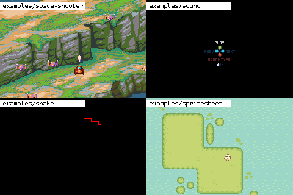

gba-experiments
---

Collection of examples and experiments for the GBA (Game Boy Advance) using [libgba](https://github.com/tarcisiofischer/libgba/).



Building
---

[libgba](https://github.com/tarcisiofischer/libgba/) must be built and installed first. See its README for instructions.

With `GBA_LLVM` set and libgba installed, configure and build with:

```
cmake -S . -B build \
  -DCMAKE_TOOLCHAIN_FILE=$LIBGBA_INSTALL/lib/cmake/libgba/gba-toolchain.cmake \
  -DLIBGBA_PATH=$LIBGBA_INSTALL/lib/cmake/libgba
cmake --build build
```

Where `LIBGBA_INSTALL` is the prefix used when installing libgba.
